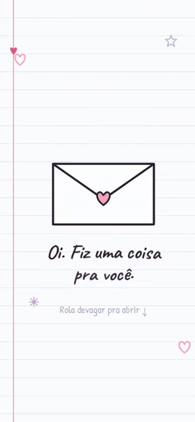

<h1 align="center">💌 Pedido de Namoro</h1>

<p align="center">
  Um pedido de namoro contado como uma história em rolagem, desenhado como uma folha de caderno.<br>
  A carta se abre, as frases aparecem uma por uma e, no fim, vem a pergunta.<br>
  <b>O botão "Não" é impossível de clicar.</b>
</p>

<p align="center">
  <a href="#como-usar">Como usar</a> ·
  <a href="#como-personalizar">Como personalizar</a> ·
  <a href="#demonstração-com-som">Vídeos com som</a>
</p>

<p align="center">
  
  
</p>

Não precisa instalar nada: é só abrir o `index.html` no navegador ou publicar a pasta no GitHub Pages e mandar o link.

## Como funciona

1. **A carta:** ao rolar, o selo estoura, a aba abre e a carta voa em direção à tela.
2. **A história:** a tela fica parada enquanto cada cena entra. O desenho se rabisca sozinho, as letras surgem do desfoque e a cor do fundo vai mudando. Um coraçãozinho na margem mostra quanto falta.
3. **A pergunta:** as letras de "Quer namorar comigo?" caem com efeito elástico, e depois de alguns segundos o "Sim" começa a chamar atenção.
   - **No computador**, o "Não" foge do mouse.
   - **No celular**, cada toque no "Não" troca o texto dele ("Tem certeza?", "Pensa bem…", "Olha que eu choro 🥺"…). Ele vai ficando menor e o "Sim" maior, até o "Não" cair.
4. **O sim:** a música começa, o bonequinho se desenha e manda um "biu", e as peças do coração caem quicando até montar o coração. Dá para estourar os coraçõezinhos com um toque e montar tudo de novo.

## Demonstração com som

**No computador:** o "Não" foge do mouse.

https://github.com/user-attachments/assets/2eac8ac9-71b6-4f12-bc59-09ed1e19e82e

**No celular:** cada toque no "Não" deixa ele menor e o "Sim" maior.

https://github.com/user-attachments/assets/b2b523d6-8aa6-47b8-af36-320877d763b6

## Como usar

**Pelo GitHub Pages (recomendado):**

1. Faça um fork deste repositório.
2. No seu fork, vá em **Settings → Pages**, escolha a branch `main` e a pasta `/ (root)` e clique em **Save**.
3. Em um ou dois minutos o site fica em `https://SEU-USUARIO.github.io/Pedido-de-Namoro/`. É esse link que você manda.

**No seu computador:** baixe o projeto (**Code → Download ZIP**), descompacte e abra o `index.html`.

## Como personalizar

| O que trocar | Onde fica |
| --- | --- |
| Frases da história | `index.html`, dentro de cada `<section class="cena">` |
| Cor de fundo de cada cena | atributo `data-cor` da mesma `<section>` |
| Quantidade de cenas | copie ou apague uma `<section class="cena">`; a rolagem se ajusta sozinha |
| A pergunta e a frase final | `index.html`, em `#pergunta-titulo` e `.festa__frase` |
| Frases do "Não" no celular | `FRASES_NAO`, no começo do `js/love.js` |
| Música | troque o arquivo `MP3/1.mp3` (mantenha o mesmo nome) |
| Título e prévia do link no WhatsApp | `<title>` e as tags `og:` no começo do `index.html` |

## Estrutura

```
├── index.html         página única: carta, história, pergunta e comemoração
├── yes.html           só redireciona para o index.html (mantém links antigos funcionando)
├── css/love.css       visual de caderno e layout
├── js/love.js         animações, botões e o coração de pecinhas
├── images/            bonequinho (GIF) e o coraçãozinho rosa (SVG)
├── MP3/1.mp3          música da comemoração
└── demo/              GIFs e vídeos deste README
```

## Tecnologia

- [GSAP 3.13](https://gsap.com) com os plugins ScrollTrigger, SplitText, DrawSVG e Physics2D: coreografia da rolagem, texto, traços e a gravidade dos confetes.
- [Lenis](https://lenis.darkroom.engineering): rolagem suave no computador. No celular, a rolagem é a do próprio aparelho.
- HTML, CSS e JavaScript puros, sem build e sem dependências para instalar.

As bibliotecas vêm por CDN. Sem internet, a página mostra as cenas uma embaixo da outra, sem animação, e continua funcionando. Quem tem a opção "reduzir movimento" ligada no sistema também recebe uma versão mais calma.
